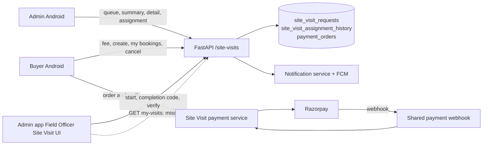
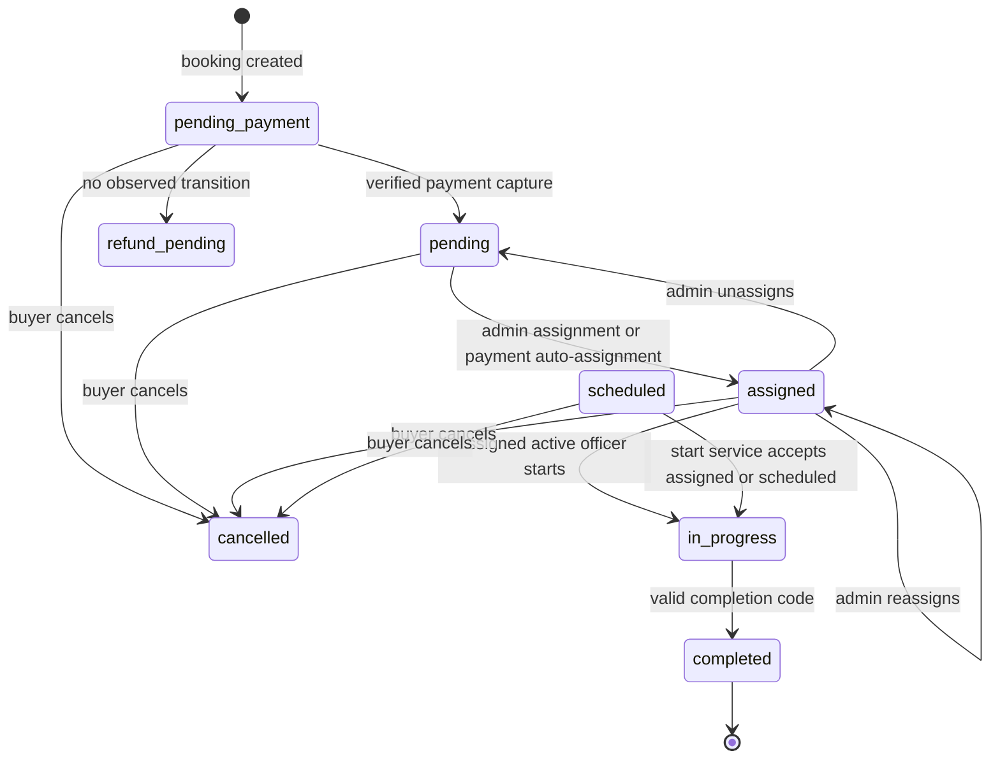

# MyBrokerr Site Visit System — Complete Architecture Audit

**Audit date:** 2026-11-16  
**Review type:** Read-only source review across backend, Buyer Android, and Admin Android repositories. No database connection, migration, grant, API request, or test/build execution was performed for this audit. Existing modified and untracked files were preserved.

## 1. Executive summary

The backend Site Visit booking and payment path is implemented, as are buyer cancellation, paid Admin queue and assignment, and Field Officer start/completion verification. Buyer Android has a booking form, booking history/status cards, Razorpay order/verify integration, and cancellation. Admin Android has Admin queue/detail/assignment UI and a Field Officer screen with lifecycle actions.

The end-to-end Field Officer experience has a blocking API gap: Admin Android calls `GET /site-visits/field-officer/my-visits`, but no matching backend route exists. Its visit detail navigation also enters an older seller-listing inspection feature instead of the paid Site Visit lifecycle. There is no implemented Site Visit refund workflow. Buyer duplicate prevention is enforced mainly in service logic; database uniqueness is for buyer submission keys and payment identifiers, not one active booking per listing. The Buyer UI does not appear to resume an existing unpaid booking when reopened from the listing.

## 2. Scope and evidence

Reviewed `app/site_visits/`, shared payment and notification services, router registration, relevant migrations, Buyer `feature/sitevisit/` files and navigation, Admin `feature/sitevisit/` files and navigation, and the legacy Admin Field Officer inspection workflow. Paths below are relative to their respective repository roots. Statements describe checked-in source in the current worktrees; Android folders and some backend paths have pre-existing local modifications/untracked files, so findings are not claims about a clean commit or deployed environment.

## 3. Architecture at a glance

FastAPI mounts `app.site_visits.router` in `app/main.py`. The router prefix is `/site-visits`. Authentication is provided by existing bearer/JWT dependencies; endpoint role dependencies are CUSTOMER, ADMIN/SUPER_ADMIN, and FIELD_OFFICER as appropriate.

## 4. Implemented backend API contract

| Method and path | Role | Function |
|---|---|---|
| `GET /site-visits/fee` | CUSTOMER | Returns fee in rupees and paise and currency. |
| `POST /site-visits` | CUSTOMER | Creates a booking from listing/date/time/count/address/message/submission key. |
| `GET /site-visits/my-bookings` | CUSTOMER | Lists buyer-owned bookings and may include the active completion code for an in-progress booking. |
| `POST /site-visits/{booking_id}/cancel` | CUSTOMER | Cancels an eligible own booking with a reason. |
| `POST /site-visits/{booking_id}/payment-order` | CUSTOMER | Creates or reuses a Razorpay order for the booking. |
| `POST /site-visits/{booking_id}/verify-payment` | CUSTOMER | Server-side verifies the order, payment, signature, amount and currency. |
| `POST /site-visits/{booking_id}/cancel-payment` | CUSTOMER | Marks a payment attempt cancelled; it does not cancel the booking or refund money. |
| `GET /site-visits/admin` | ADMIN/SUPER_ADMIN | Lists paid bookings with pagination, status, officer, date and search filters. |
| `GET /site-visits/admin/summary` | ADMIN/SUPER_ADMIN | Counts paid bookings by status. |
| `GET /site-visits/admin/field-officers` | ADMIN/SUPER_ADMIN | Lists eligible active Field Officers. |
| `GET /site-visits/admin/{request_id}` | ADMIN/SUPER_ADMIN | Returns paid booking detail and assignment history. |
| `PUT /site-visits/admin/{request_id}/assignment` | ADMIN/SUPER_ADMIN | Assigns or reassigns an eligible officer. |
| `DELETE /site-visits/admin/{request_id}/assignment` | ADMIN/SUPER_ADMIN | Removes an eligible assignment, with a note body. |
| `POST /site-visits/field-officer/{booking_id}/start` | FIELD_OFFICER | Starts an assigned paid visit. |
| `POST /site-visits/field-officer/{booking_id}/completion-code` | FIELD_OFFICER | Initiates or reuses the active completion code. |
| `POST /site-visits/field-officer/{booking_id}/verify-completion` | FIELD_OFFICER | Validates the six-digit buyer code and completes the visit. |

No route for `GET /site-visits/field-officer/my-visits` was found in the backend router or Site Visit source. There is no direct buyer “get booking for listing” route; buyers receive their full owned list.

## 5. Booking request, validation, and response

`SiteVisitRequestCreate` in `app/site_visits/schemas.py` accepts `listing_id`, `preferred_visit_date`, `preferred_visit_time`, `visitor_count`, `pickup_address`, optional `message`, and optional `submission_key`. Extra fields are rejected. Date is a date and time is a time (the API field names and date/time representations remain the existing contract). Date cannot be earlier than `site_visit_today()`, which uses a fixed UTC+05:30 business timezone. Visitor count is 1–20; address is 10–1000 characters; message is at most 2000; submission key is at most 64.

The service locks the listing row, verifies it exists and is LIVE, rejects booking one’s own listing, requires the seller and the buyer’s registered mobile, reads the configured fee, snapshots listing/buyer/seller display data, and creates the request in `pending_payment` with payment status `initiated`. The fee is stored in paise and is a booking-time snapshot. The Buyer request DTO retains `preferred_visit_date` and `preferred_visit_time` and sends `submission_key`; the backend expects those names.

Booking responses use `id` for the numeric Site Visit request ID, `listing_id` for the numeric Sell Land row ID, and `listing_code` for the human-facing listing code (generated by Sell Land as `MB-…`). The response does not define a separate human-friendly Site Visit reference. Razorpay order ID and payment ID are different identifiers again.

## 6. Duplicate prevention and resume behavior

The service checks for an existing request by buyer and listing. A repeated submission key is treated as a duplicate submission; an existing request in an active status (`pending_payment`, `pending`, `assigned`, `scheduled`, or `in_progress`) is rejected with conflict. Listing-row locking narrows races between concurrent creates. The database has unique `(buyer_id, submission_key)`, unique `payment_order_id`, and unique `payment_id`; it does **not** have a unique constraint for active buyer/listing requests. Thus active duplicate protection depends on service behavior and its transaction/locking model.

The buyer can discover outstanding bookings through `GET /my-bookings`, but the create-conflict response does not return the existing booking. The current Buyer screen loads bookings for its status/history UI but does not select and resume a matching pending booking on entry; a second submit can therefore reach the conflict instead of continuing that booking’s payment. A dedicated lookup or conflict response that identifies the existing booking would make recovery explicit. This is an improvement opportunity, not a claim that duplicate payment can be created through the normal service path.

Payment order creation is tied to the booking and checks booking ownership, state, linkage, amount and currency. It reuses a still-payable existing order where possible. A new attempt may be created after a previous order is terminal/expired. Shared payment order rows have a Site Visit request link; the model does not declare that link unique, so a booking can have historical attempts.

## 7. State model and transitions

Backend `SiteVisitStatus` values and database check constraint are: `pending_payment`, `pending`, `assigned`, `scheduled`, `in_progress`, `completed`, `cancelled`, `refund_pending`, `refunded`, `refund_failed`. Payment status is constrained to `initiated`, `success`, or `failed`.

Although `scheduled` is represented and can be filtered/displayed, no scheduling mutation route or service transition was found. The admin assignment action sets `assigned`, not `scheduled`. Admin list/summary operates on successfully paid requests; unpaid `pending_payment` rows are excluded. Cancellation has no implemented refund/status transition.

## 8. Payment flow and security boundaries

The Site Visit payment context is `site_visit` in `app/site_visits/payment_service.py`; payment attempts are stored in the shared payment-order model with booking linkage, user/listing, amount, INR currency, and provider identifiers. The backend calculates amount from the fee snapshot. The Buyer calls payment-order, launches Razorpay from returned order data, then posts Razorpay order ID, payment ID and signature to verify. Amount is intentionally not accepted from the client’s verify request.

Capture validation checks order context, booking/user/listing linkage, expected amount, INR, provider payment/order IDs, provider amount/currency/status. A successful capture updates payment status and moves `pending_payment` to `pending`, then auto-assigns to the listing’s active verifier when one exists. The shared Razorpay webhook dispatches Site Visit orders to Site Visit handling. Duplicate captures are recorded for reconciliation while the already-paid booking is preserved. Payment order records and webhook deduplication support are part of the shared payment layer.

### Payment cancellation and refunds

`cancel-payment` reports/cancels a payment attempt; buyer booking cancellation is a separate endpoint. Booking cancellation sets status `cancelled`, reason, and timestamp when status is in the buyer-cancellable set (`pending_payment`, `pending`, `assigned`, `scheduled`). It does not change payment status or call a provider refund. No dedicated Site Visit refund endpoint, automatic/manual refund service, refund amount calculation, refund identifier, or refund completion handler was found. Refund-related enum values, summary fields and display DTOs exist, but the audited Site Visit source contains no transition into those refund states. Treat refunds as **not implemented in this workflow**, not as implied by the enum.

## 9. Admin assignment behavior

Admin queue/detail/officer endpoints require ADMIN or SUPER_ADMIN. The service only exposes paid bookings. A target officer must be an active FIELD_OFFICER. Assignment is allowed from paid `pending` with no assigned officer and no in-progress/completed lifecycle. Reassignment is allowed while assigned and before progress. Unassignment returns an assigned booking to pending when it has not been scheduled, started or completed. Each mutation writes `site_visit_assignment_history` with action (`assigned`, `reassigned`, `unassigned`), actor type (`system`, `admin`, `super_admin`), old/new officer IDs, actor, note and timestamp.

Successful payment can auto-assign the listing’s active verifier and record a system assignment. If there is no valid verifier, the booking remains paid `pending` for Admin assignment.

## 10. Field Officer lifecycle and completion code

Start, completion initiation and verification require the logged-in user to be the currently assigned, active Field Officer and the booking to be paid. Start accepts `assigned` or `scheduled`, changes it to `in_progress`, and writes `started_at`.

Completion initiation is permitted only for `in_progress`. It creates a six-digit code; the code is stored hashed and encrypted with configured keys, expires in 10 minutes, and is limited to five failed checks. The officer endpoint returns booking status and expiry, not the plaintext code. The Buyer’s own booking list returns the decrypted active code only while in progress, unused, unexpired, and below the attempt limit; the buyer shares it with the officer. Correct verification marks `completed`, stores completion time, marks code used, and clears hash/cipher. Expiry or five failures invalidates the code; the officer may initiate a fresh one after expiry but not after the five-attempt lock.

## 11. Database model and constraints

`site_visit_requests` stores listing, buyer, seller, assigned officer IDs; name/mobile/listing snapshots; requested date/time, visitor count, pickup address and message; submission key; fee paise; booking/payment statuses; payment IDs; paid/scheduled/started/completed/cancelled timestamps; cancellation reason; completion-code hash/cipher/expiry/attempt/used fields; created/updated timestamps. It has foreign keys to listing/users, checks for nonnegative fee, visitor count and valid enum strings, unique buyer/submission key, and unique booking payment-order/payment IDs.

`site_visit_assignment_history` stores assignment actions and actor/officer references with checks for valid action/actor type and target shape. Shared `payment_orders` carries the `site_visit_request_id` link. Relevant revisions are `20261115_0037` through `20261115_0042`: fee setting; Site Visit foundation tables; payment context; payment-attempt link; unique Razorpay webhook event key; completion-code fields. This audit only inspected migration source; it did not check a database’s applied revision or production schema.

## 12. Notification and FCM behavior

Backend notification event names include `SITE_VISIT_ASSIGNED`, `SITE_VISIT_ASSIGNMENT_REMOVED`, `SITE_VISIT_COMPLETION_CODE_READY`, and `SITE_VISIT_COMPLETED`. Assignment events target affected officers; assignment after successful payment also notifies the officer. Completion-code-ready and completed events target the buyer and active admins/superadmins. Notification records are written through the shared notification service, then FCM is attempted. Callers catch/log delivery failures; no retry mechanism specific to Site Visit was found. Completion code itself is not included in notification data.

No Site Visit notification is sent on initial booking or buyer cancellation in the reviewed service. Buyer route mappings send completion-ready/completed and assigned events toward `my_site_visits`. Admin notification files include Site Visit support in the current worktree, but delivery and deep-link behavior depend on the app’s existing notification handling.

## 13. Buyer Android architecture

Buyer code is under `app/src/main/java/com/example/myapplication/ui/feature/sitevisit/`. `data/SiteVisitApi.kt` defines DTOs and Retrofit methods for fee, create, my bookings, cancellation, payment order/verification and payment-attempt cancellation. `data/SiteVisitRepository.kt` wraps API calls. `presentation/SiteVisitViewModel.kt` owns screen state and booking/payment actions; `presentation/SiteVisitScreen.kt` renders booking and status/history UI. Navigation in `ui/feature/navigationGraph.kt` has listing entry `site_visit/{listingId}` and `my_site_visits` routes. The screen is entered with listing ID for booking and ID zero for history.

The screen includes date/time selection, fee/listing display, visitor/address/message fields, submit, payment flow, refresh, booking status and cancellation. Source does not establish end-to-end behavior against a live backend here; this was a code audit, not a runtime test.

## 14. Admin Android architecture and integration defects

Admin Site Visit DTOs/API/UI are in `feature/sitevisit/SiteVisitApi.kt` and `SiteVisitScreens.kt`; navigation exposes the Admin Site Visit queue and Field Officer Site Visit screen. Admin UI loads list/summary/officers/details and can assign/unassign. The Field Officer screen uses `SiteVisitApi.myVisits()` plus start/initiate/verify actions.

**Blocking mismatch:** that Retrofit method requests `GET site-visits/field-officer/my-visits`, absent from the backend. The UI therefore cannot load assigned visits from this backend route as written.

**Navigation mismatch:** Field Officer list selection navigates through `Routes.fieldSiteVisit(id)` to `feature/fieldofficer/sitevisit/SiteVisitScreen` (`RootNavGraph.kt`). That screen’s ViewModel uses `FieldOfficerRepository` and the seller listing case/detail API, location tracking and photo/review workflow. It is a separate listing verification process and does not call the Site Visit start/completion endpoints. The newer booking lifecycle UI is in `feature/sitevisit/SiteVisitScreens.kt`; route wiring should keep its selection/detail/actions within that flow.

## 15. Human identifiers and display semantics

`MB-xxxxxx` is the Sell Land `listing_code`, copied into a Site Visit booking snapshot and returned as `listing_code`. `listing_id` is the integer Sell Land row key. Site Visit `id` is the numeric booking key used by booking/payment/lifecycle paths. Razorpay `order_id` and `payment_id` are payment-provider keys. UI labels should distinguish “Listing” from “Site Visit booking” and avoid representing a listing code as a booking code.

## 16. Access control and sensitive information

Buyer endpoints scope list/cancel/payment to the authenticated buyer. Admin queue/detail/mutations require ADMIN/SUPER_ADMIN. Officer lifecycle service checks active FIELD_OFFICER status and assignment ownership in addition to role dependency. No Site Visit endpoint returns seller contact or booking detail to the buyer response; Admin/Field Officer DTOs include buyer/seller contacts for operational use. Completion code plaintext is limited to the buyer-owned active-booking response, and is never included in the FCM payload. Payment verification is server checked; price is server sourced.

Configuration needed for completion-code encryption/HMAC is read from backend settings. Deployment must provide valid keys; missing crypto configuration makes completion initiation/verification unavailable. This audit did not inspect or expose secret values.

## 17. Test coverage found (not run)

Backend has Site Visit tests for buyer API, Admin API, assignment, completion code, payment, foundation, and a MySQL payment integration case under `tests/`. Buyer Android has Site Visit unit tests under `app/src/test/.../sitevisit/`. The presence of tests is not evidence that they pass. No tests were run for this architecture-only task.

## 18. Findings by severity

| Severity | Finding | Practical effect |
|---|---|---|
| Blocker | Admin Field Officer list calls missing `GET /field-officer/my-visits`. | Assigned visits cannot be loaded through the declared API. |
| Blocker | Selected visit route opens legacy listing inspection detail. | Booking lifecycle controls and data model do not match the paid Site Visit workflow. |
| High | No automatic or manual Site Visit refund implementation found. | Paid cancellation is not a refund; refund status values alone do not move money. |
| High | Active buyer/listing duplicate protection is service-only, with no active-pair DB constraint. | Concurrency correctness depends on service locking and database transaction semantics. |
| Medium | Buyer UI does not resume an existing unpaid booking by listing after conflict/re-entry. | Buyer may need to find it in booking history before retrying payment. |
| Medium | `scheduled` exists but no schedule mutation was found. | Status is representable but not currently set by reviewed Site Visit actions. |
| Medium | Booking ID, listing ID/code, and payment IDs can be conflated in UI copy. | User-facing support and navigation can refer to the wrong record. |
| Medium | Notification failure is caught/logged without Site Visit-specific retry. | Persisted notification can exist while push delivery is missed. |

## 19. Recommended follow-up order

1. Add an authenticated Field Officer assigned-bookings endpoint with response fields matching `FieldOfficerVisitDto`; filter to the authenticated active officer and relevant paid statuses.
2. Keep Field Officer Site Visit selection/detail/actions in the Site Visit feature, and route to a booking-specific Site Visit detail screen rather than the legacy Sell Land case screen.
3. Define the product and accounting contract for paid cancellation/refunds, then implement provider refund initiation, idempotency, reconciliation, refund states and notifications. Until then, do not imply cancellation returns funds.
4. Add a durable active duplicate policy (such as a database-supported strategy appropriate to MySQL) and an explicit resume path returning the existing unpaid booking after duplicate create attempts.
5. Either implement an explicit scheduling transition/actor or remove the unused `scheduled` state from UI expectations until defined.
6. Improve notification delivery observability/retry and distinguish booking ID from listing code in user-facing text.
7. Run the existing isolated test suites and Android builds after implementation; keep MySQL integration tests isolated from production configuration.

## 20. Audit limits and artifact change

This report is a static source audit. No production or test database was contacted; applied migrations, data integrity, provider account behavior, runtime FCM delivery, and deployed API availability were not verified. No test or build result is asserted. The only file created for this audit is this document. Pre-existing modified and untracked files were left untouched.
